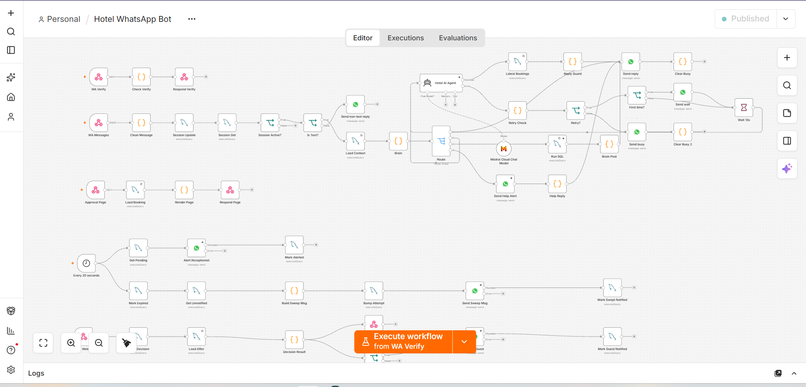
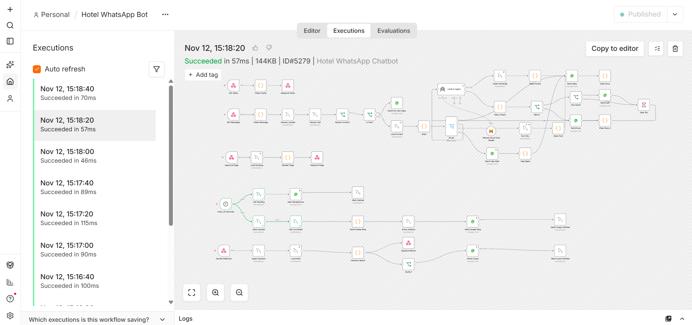
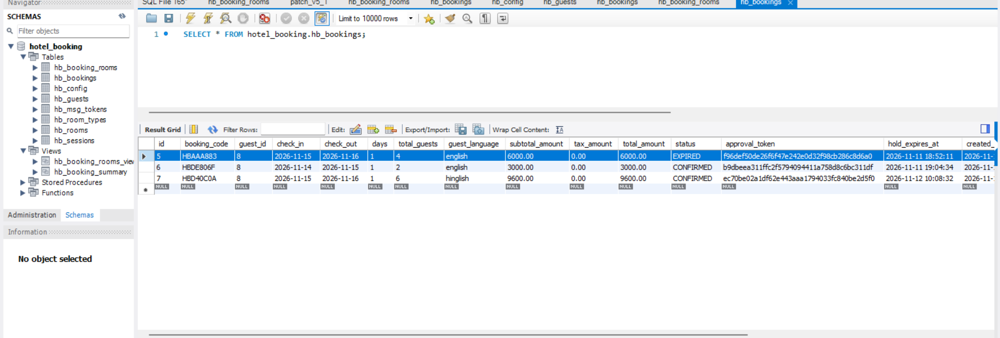
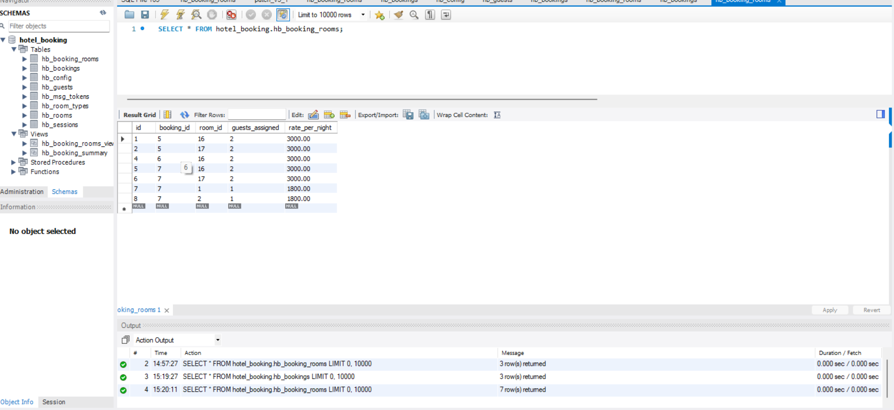
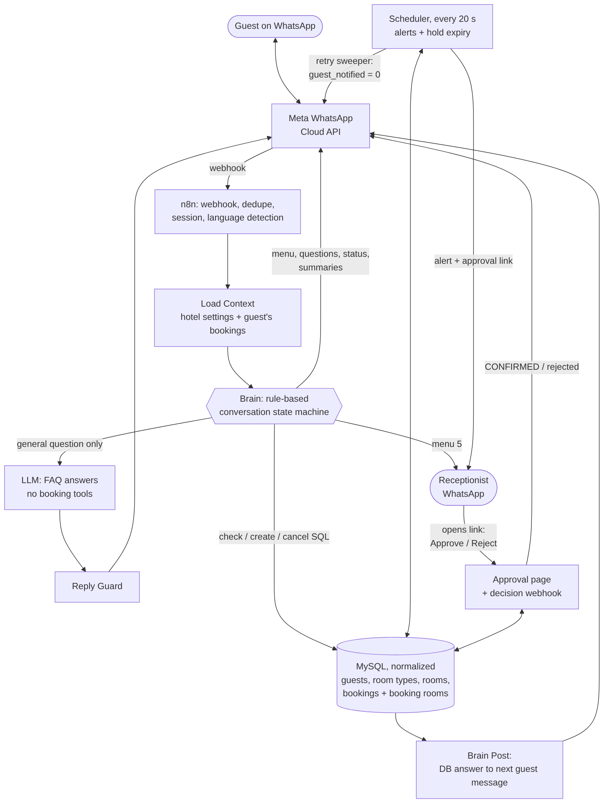
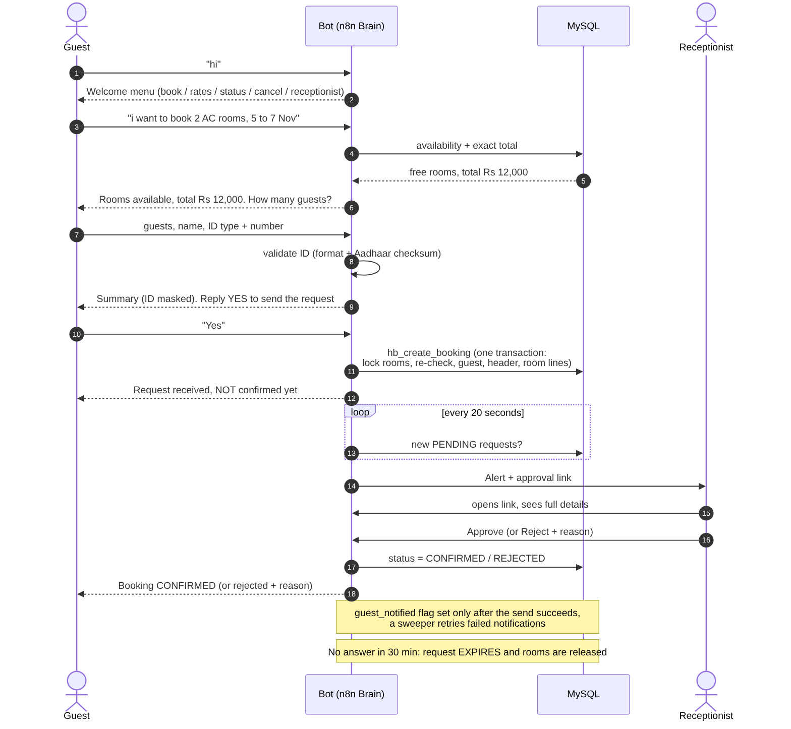
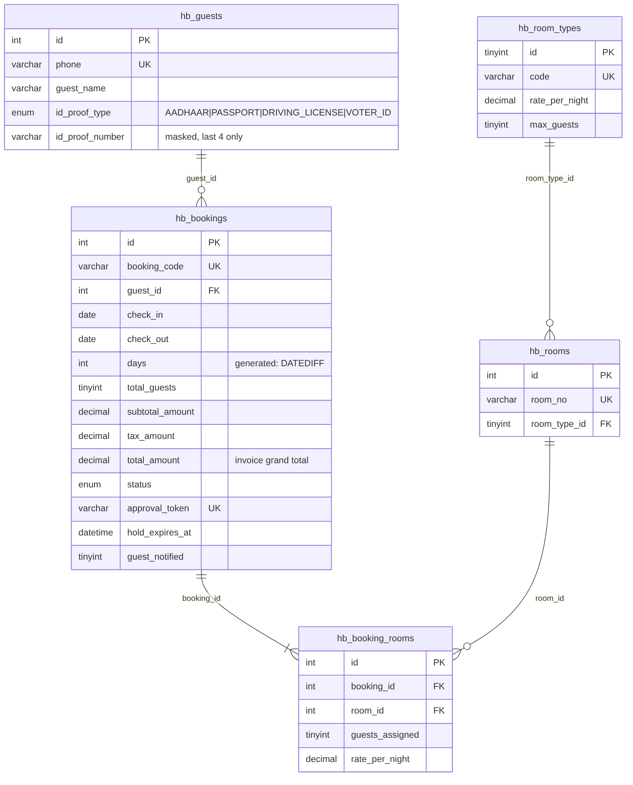

# WhatsApp Hotel Booking Agent

A WhatsApp receptionist for a 30-room hotel. Guests book rooms, check prices, see their booking status and cancel in plain English, Hinglish or Hindi. **The bot never confirms a booking itself**: every request is held for 30 minutes and the human receptionist approves or rejects it from a one-tap link.

Built with **n8n**, **MySQL**, the **WhatsApp Cloud API** and an LLM that is used only for general questions.

> Demo video: [Watch the demo](docs/demo.mp4)

## Design approach

A hotel cannot afford a chatbot that guesses. So the booking flow is a **rule-based state machine** (a Code node called `Brain`), the way a real front desk works, and everything that involves money, availability, identity or a promise is decided by code and the database. An LLM is used only where language is open-ended: general questions such as wifi or parking. It has no booking tools and never sees or calculates a total.

## What it does

- **Welcome menu** for every new chat: book a room, rates and info, booking status, cancel, talk to the receptionist.
- **Guided booking**: dates, AC / Non-AC rooms, live availability and exact price, guests, name, ID proof, summary, YES. It also understands a whole request in one message, for example `mujhe 2 AC aur 1 non ac room chahiye 25 nov se 27 nov`.
- **English, Hinglish and Hindi (Devanagari)**: language is detected in code and every reply template exists in all three.
- **Prices and totals come from the database**; the bot can show how a total was calculated (rate x rooms x nights).
- **Helpful sanity checks**: max 4 guests per room; if guests are fewer than or equal to rooms (for example 6 rooms for 6 guests) the bot suggests fewer rooms and lets the guest keep, change the rooms, or change the guest count. Guests, rooms and dates can be corrected even at the final summary.
- **ID proof validated in the backend**: Aadhaar 12 digits with the Verhoeff checksum, plus passport, driving licence and voter ID formats. Only a masked number is stored, and the database refuses an ID number the guest did not type in this chat.
- **Receptionist approval**: a booking is created as `PENDING`, rooms are held for 30 minutes, the receptionist gets a WhatsApp alert with a link to a page showing the full booking with **Approve / Reject**.
- **Guest is notified** when the request is confirmed, rejected or expired. A `guest_notified` flag plus a sweeper retries failed sends.
- **Automatic expiry** after 30 minutes; **status and cancellation** from chat (cancel within 6 hours).
- **General questions** (wifi, parking, ...) go to the LLM, which only knows the fixed hotel facts, never invents prices or booking details, and sends the guest back to the menu or the receptionist when unsure.

## Screenshots






## Architecture



Booking flow:



## Challenges and how they are solved

| Problem | Decision |
|---|---|
| Chatbots can guess availability, prices and confirmations | Booking is a deterministic state machine (`src/brain.js`). Totals come from SQL. The LLM has no tools and is told never to explain or calculate a booking total. |
| The bot must not "confirm" a booking | New bookings are `PENDING`. The only "booked" message says "NOT confirmed yet"; confirmation is sent by the approval flow after the receptionist decides. |
| Two guests asking for the same room at the same time | Booking runs in **one transaction** (`hb_create_booking`): it locks candidate room rows with `SELECT ... FOR UPDATE`, re-checks availability under `READ COMMITTED`, then writes guest, header and room lines. Tested with 10 parallel requests for 15 rooms: exactly 5 succeed. |
| Guests type free text | Dates (`12 se 15 nov`, `kal`, `2 nights`), rooms (`2 AC aur 1 non ac`), guests and ID are parsed by regular expressions in English, Hinglish and Hindi; anything unclear is re-asked or sent to the FAQ model. |
| Approval links must be safe | Random 40-character token (`RANDOM_BYTES`, unique-indexed); the page and decision endpoint check code + token + status + expiry. |
| ID numbers are sensitive | Only the last 4 digits are stored. The draft ID lives in n8n static data until the guest says YES and is deleted right after. |
| Webhook retries from Meta | De-duplication by WhatsApp message id. |

## Tech stack

n8n (self-hosted, Docker) - WhatsApp Cloud API (Meta) - MySQL / MariaDB - Mistral Cloud chat model for FAQ answers (swappable) - ngrok for the public webhook URL.

## Data model



Normalized (3NF) schema in [`sql/schema.sql`](sql/schema.sql):

| Table | Purpose |
|---|---|
| `hb_guests` | CRM: one row per phone (unique). ID proof split into `id_proof_type` (ENUM) and a **masked** `id_proof_number`. |
| `hb_bookings` | Header, **one row per `booking_code`**: dates, `total_guests` (stored once), `subtotal_amount`, `tax_amount`, `total_amount` as `DECIMAL(10,2)`, status, approval token, hold expiry, notification flags. `days` is a generated column (`DATEDIFF`), with `CHECK (check_out > check_in)`. |
| `hb_booking_rooms` | Line items: `room_id` foreign key, `guests_assigned`, frozen `rate_per_night`. `UNIQUE(booking_id, room_id)`. |
| `hb_rooms`, `hb_room_types` | Inventory and pricing / capacity per category (no room strings in bookings). |
| `hb_sessions`, `hb_config` | Chat window and settings (receptionist number, public URL, tax percent). |

Constraints and indexes: unique `booking_code`, `approval_token`, `phone`; composite indexes on `(check_in, check_out)` and `(status, hold_expires_at)`; foreign keys everywhere. The view `hb_booking_summary` rolls rooms up per booking (and reports a lapsed PENDING hold as `EXPIRED`).

Routines: `hb_create_booking` (transaction), `hb_free_rooms`, `hb_validate_id` (+ `hb_verhoeff_ok`, `hb_mask_id`, `hb_norm_id_type`). `hb_msg_tokens` stores SHA-256 hashes of what the guest typed, so the database can prove an ID number came from the guest.

## Setup

1. **Database**: run `sql/schema.sql` in MySQL (MySQL 8.0.16+ or MariaDB 10.6+), then edit `receptionist_phone` and `public_url` in `hb_config`. Coming from the v4 single-table layout? Run `sql/migration_v5_from_v4.sql` instead (old tables are renamed, not dropped).
2. **n8n**: run n8n (Docker) with `WEBHOOK_URL` set to your public HTTPS URL (ngrok or a domain).
3. **Import** `workflow/hotel_whatsapp_bot.json`, then select your credentials: MySQL, WhatsApp, and your LLM provider (the export uses Mistral `codestral-2508`). Set `hotel_name` in `hb_config` for the welcome message.
4. **Meta app**: create a WhatsApp app, put your Phone Number ID in the send nodes, and set the webhook callback to `<public_url>/webhook/hotel-wa` with the same verify token as in the workflow. Subscribe the app to `messages`.
5. **FAQ prompt**: already inside the `Hotel AI Agent` node (`prompts/faq_prompt.txt` is the same text for reference).
6. **Publish** the workflow. Message the Meta test number; the receptionist number must also message the bot once so alerts can be delivered (24-hour rule).

## Limitations

- Uses the Meta **test number**: only numbers on the allowed list can be messaged.
- WhatsApp's **24-hour rule**: free-form receptionist alerts only reach a number that messaged the bot in the last 24 hours. A production setup should use an approved message template, or alert through Telegram or email.
- The rule-based parser understands the phrasings it was written for; very unusual wording is re-asked or sent to the FAQ model. Add rules in `src/lib.js` when real chats show a gap.
- Only the FAQ answers use the LLM, so a rate-limited or offline model no longer blocks bookings.
- Approval links are protected by a random token only (no login), so send them only to the receptionist.
- Rooms only, no payment gateway (pay at hotel). Tax is configurable (`tax_percent` in `hb_config`, default 0); if you enable it, also update the prompt line about taxes.
- ID numbers pass through n8n execution logs and static data while being collected; enable execution-data pruning in n8n. Only the masked value is stored in the database.
- The fixed rates in the FAQ prompt are static; keep them in sync with `hb_room_types`.

## Roadmap

Template-based alerts, receptionist dashboard, seasonal rates, voice-note and photo handling, Docker Compose for one-command setup, CI for the tests.

## Project structure

```
docs/        architecture + sequence + ER diagrams (Mermaid source and PNG), demo script
prompts/     FAQ model prompt
sql/         normalized schema, routines, v4 migration
src/         readable source of the Code nodes: lib.js (parsers, ID rules), msgs.js (EN/HI/Hinglish texts),
             brain.js (conversation state machine), brain_post.js (DB answer to message), ctx.sql
workflow/    n8n export of the guided bot (sanitized) + v5_llm_agent_variant.json (the earlier LLM-agent version)
tests/       conversation_test.js (30 end-to-end checks), db_layer_tests.js (33 SQL / approval checks), concurrency_test.py
```

## Author

Aadarsh Sharma - [GitHub](https://github.com/14aadarsh) - [LinkedIn](https://linkedin.com/in/aadarsh-sharma-57b788288)

License: MIT
